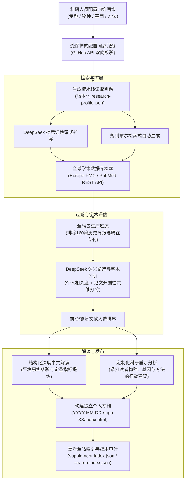
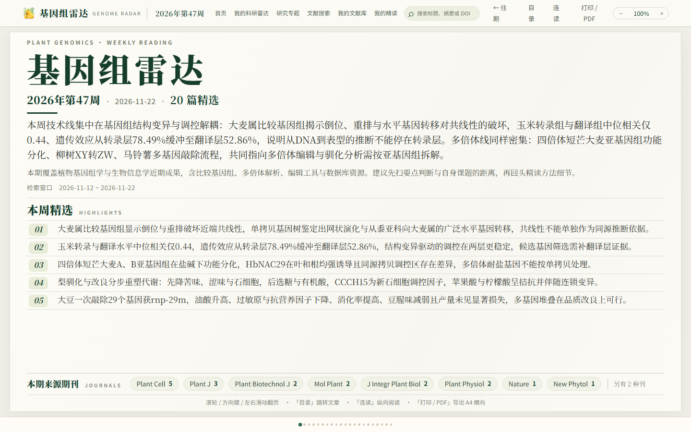
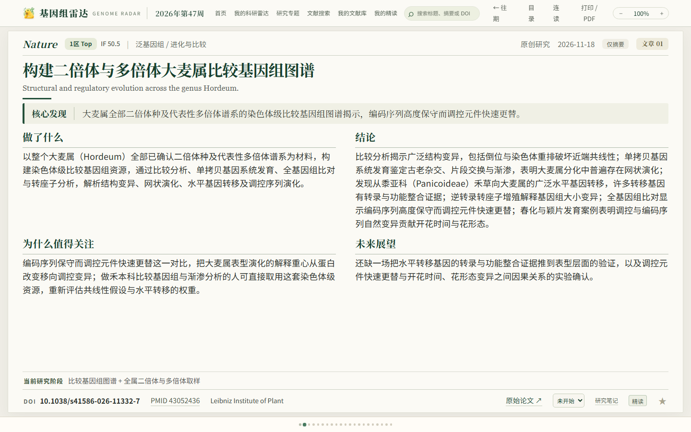
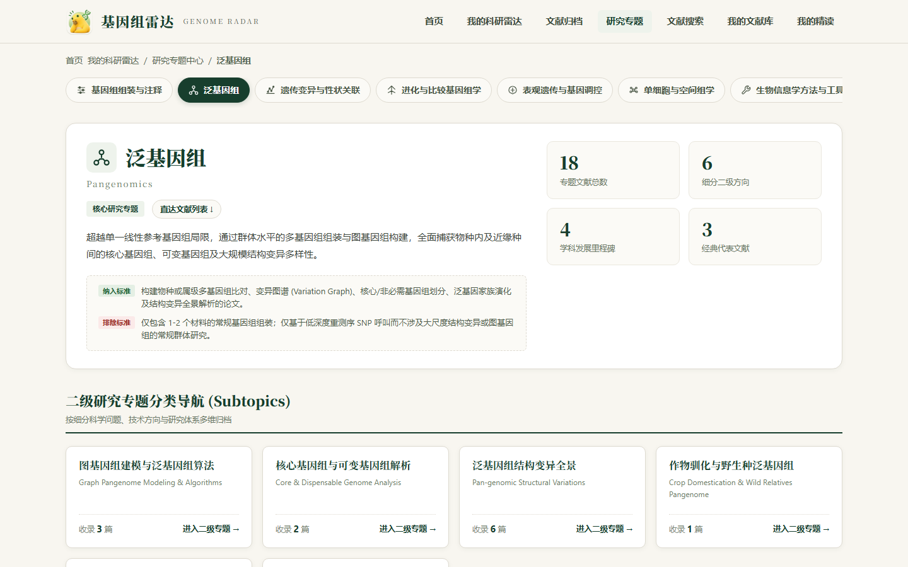
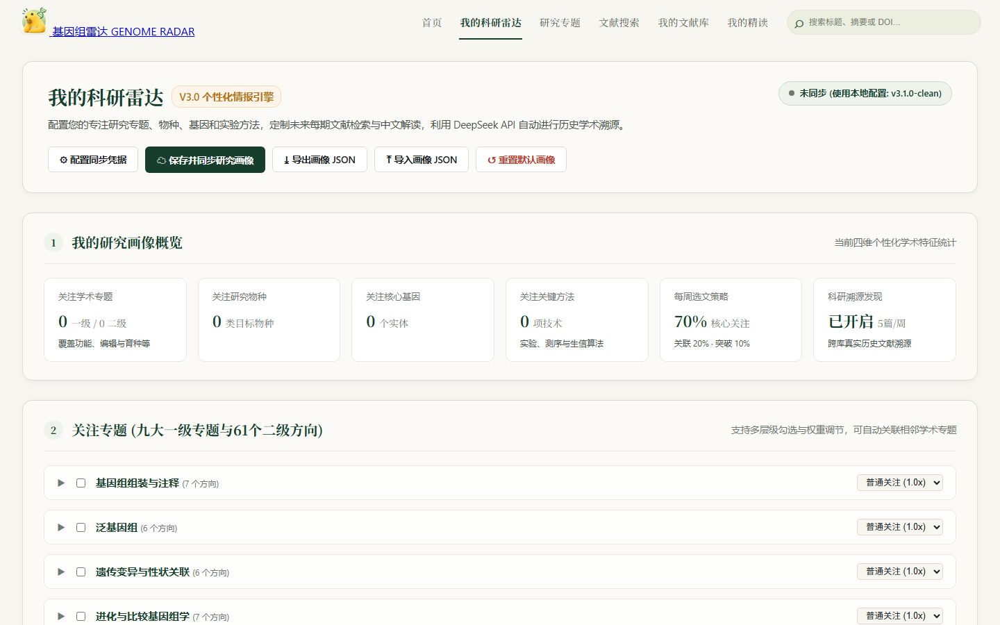
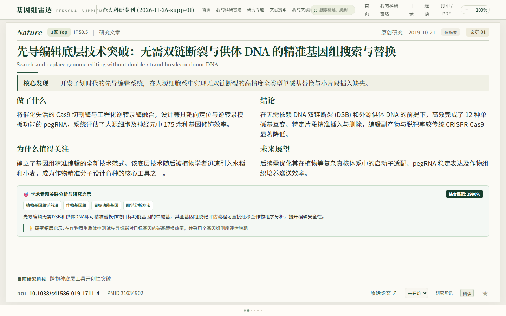
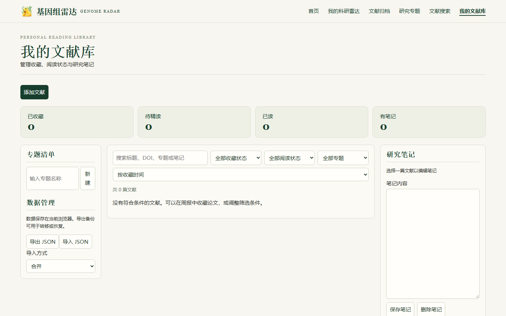
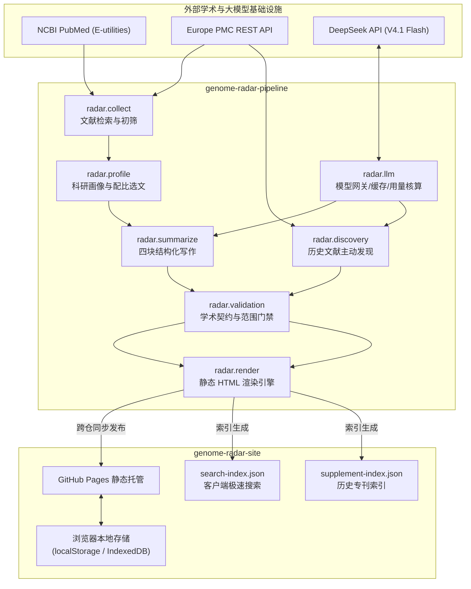
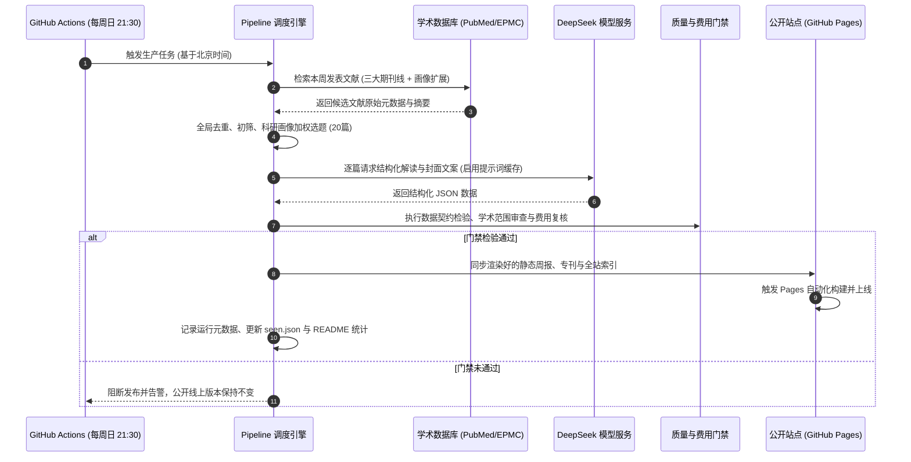

<p align="center">
  
</p>

<h1 align="center">基因组雷达 · Genome Radar</h1>

<p align="center">
  <strong>面向植物基因组学的个性化科研情报与文献知识管理平台</strong><br>
  集成每周学术精选 · 多维研究专题 · DeepSeek 智能解读 · 个人科研雷达 · 历史文献发现 · 沉浸式精读工作台
</p>

<p align="center">
  <a href="https://hao1006sy-source.github.io/genome-radar-site/"><strong>🌐 访问在线平台</strong></a> •
  <a href="https://hao1006sy-source.github.io/genome-radar-site/my-radar.html"><strong>🎯 我的科研雷达</strong></a> •
  <a href="https://hao1006sy-source.github.io/genome-radar-site/topics.html"><strong>📚 研究专题门户</strong></a> •
  <a href="https://hao1006sy-source.github.io/genome-radar-site/search.html"><strong>🔍 全站文献搜索</strong></a> •
  <a href="https://hao1006sy-source.github.io/genome-radar-site/library.html"><strong>📖 个人文献库</strong></a>
</p>

<!-- DYNAMIC_STATS_START -->
> **项目动态统计**（数据驱动实时自动同步，最后更新：`2026-11-26`）
>
> [](https://hao1006sy-source.github.io/genome-radar-site/search.html) [](https://hao1006sy-source.github.io/genome-radar-site/) [](https://hao1006sy-source.github.io/genome-radar-site/topics.html) [](https://hao1006sy-source.github.io/genome-radar-site/my-radar.html) [](https://api.deepseek.com) [](LICENSE)

| 核心统计指标 | 当前数据值 | 数据统计来源与说明 |
| :--- | :--- | :--- |
| **全站收录学术文献** | **175 篇** | 包含 160 篇每周精选最新研究 + 15 篇个性化发现专刊文献 |
| **常规周报期数** | **8 期** | 首期归档自 2026-10-04 至最新期次 `2026-11-22`（每期 20 篇） |
| **多级学术分类体系** | **9 大一级 / 61 个二级** | 覆盖基因组学全链条，严格多标签交叉归档与证据链核验 |
| **个人科研专刊记录** | **3 期** | 依据四维科研画像动态检索 Europe PMC / PubMed 与 DeepSeek 研判生成 |
| **学术文献检索接口** | **PubMed + Europe PMC** | 实时调用真实官方 API，严格通过 DOI / PMID 全局去重（已收录 170+ 去重记录） |
| **模型调用与真实开销** | **累计调用 17 次 / $0.009809** | 实际折合约 ¥0.0701，提示词缓存命中享折价，本地磁盘缓存零费用 |
<!-- DYNAMIC_STATS_END -->

---

## 目录

- [一、项目介绍](#一项目介绍)
- [二、核心功能](#二核心功能)
- [三、学术分类体系 (九大一级与61个二级专题)](#三学术分类体系)
- [四、我的科研雷达与个性化情报体系](#四我的科研雷达与个性化情报体系)
- [五、网站界面展示](#五网站界面展示)
- [六、技术架构与系统设计](#六技术架构与系统设计)
- [七、学术质量控制与数据治理](#七学术质量控制与数据治理)
- [八、版本演进与更新日志](#八版本演进与更新日志)
- [九、项目运行与本地维护指南](#九项目运行与本地维护指南)
- [十、开源协议与学术引用](#十开源协议与学术引用)

---

## 一、项目介绍

### 1. 建设背景
随着长读长高精度测序、单倍型分相组装、超大规模多组学以及人工智能辅助计算生物学技术的迅猛发展，植物与作物基因组学文献呈现爆发式增长。异源多倍体染色体复杂性、泛基因组大尺度结构变异、微观表观时空异质性等前沿方向的研究深度与广度持续拓宽。然而，传统依赖通用文献数据库关键词检索或粗粒度 RSS 订阅的追踪模式，存在**海量无关文献噪音大、跨学科分类标准混乱、难以穿透原始英文摘要快速提取定量指标、无法沉淀个人课题专属文献知识**等学术痛点。

### 2. 学术定位
**基因组雷达（Genome Radar）** 定位于服务植物科学、农作物遗传育种、进化与比较基因组学以及计算生物学研究群体的专业科研情报与文献知识管理平台。项目已由早期的静态学术周报全面升级为集**科研情报主动发现、个性化文献智能追踪、领域学术知识归档与本地隐私深度精读**于一体的学术科研平台。

### 3. 核心价值与适用方向
- **学术专业性**：严格过滤非植物材料与缺乏基因组学证据的文献，坚持以学术事实与实验证据为第一准则。
- **个性化智能研判**：依托四维科研画像与真实调用 DeepSeek 大模型，打通“用户关注方向 ➔ 国际学术数据库检索 ➔ 语义评价 ➔ 专刊生成”的科研闭环。
- **纯粹深度阅读体验**：坚持 100% 宽屏纯文字排版、一文一页横向切页、无广告无弹窗干扰，融合双栏 PDF 本地精读与 Markdown 报告导出。
- **重点支持的研究方向**：
  - 植物参考基因组端粒到端粒 (T2T) 与单倍型精细组装；
  - 动植物图形泛基因组、超泛基因组与大规模染色体结构变异；
  - 群体高通量测序、复杂农艺性状 GWAS、QTL 定位与单倍型演化；
  - 古多倍化全基因组复制 (WGD)、共线性与比较进化基因组学；
  - DNA 甲基化、染色质开放性、3D 基因组三维构象与表观遗传调控；
  - 植物单细胞转录组、空间转录组与时空细胞谱系图谱；
  - 生物信息学算法、深度学习模型、长读长测序与分析软件工具；
  - 重要农艺性状关键功能基因克隆、抗逆耐寒机制与代谢网络；
  - CRISPR/Cas 系统、先导编辑 (Prime Editing)、单碱基编辑与分子设计育种。

---

## 二、核心功能

| 功能模块 | 功能特征与实现说明 |
| :--- | :--- |
| **每周学术精选** | 每周日自动追踪最新发表论文，精选 20 篇植物与作物基因组学高价值研究，覆盖主流期刊，保持持续学术归档。 |
| **结构化中文解读** | 彻底摒弃套话，提炼「做了什么（实验材料/技术路线）」、「核心发现（具体机制/关键定量指标）」、「为什么关注（学术价值/启发）」及「未来展望（客观局限与待验证点）」。 |
| **九大一级与61个二级专题** | 依据严谨学科分类标准构建分层学术体系，覆盖基因组学全链条，支持多标签交叉归档与证据溯源。 |
| **学科发展史与里程碑文库** | 归档各专题开创性与奠基性代表成果（如 MCScanX、Minigraph 等），呈现学科时间轴与演进脉络。 |
| **我的科研雷达** | 独立的单用户个性化科研情报页面，建立个人专属文献流。 |
| **四维科研画像配置** | 支持用户在专题、物种（拉丁名/中文名/英文名）、目标功能基因及实验研究方法四个维度自由定制关注标签与权重。 |
| **个性化选文与分层配比** | 选文引擎依据读者画像动态加权，维持“核心研究方向（约50%）+ 关联拓展方向（约30%）+ 跨领域突破创新（约20%）”的科学配比。 |
| **DeepSeek 智能检索与研判** | 真实调用 DeepSeek 大模型执行学术检索式自动扩展、候选论文语义相关度评分、中文结构化深度解读与读者定制化启示生成。 |
| **历史高相关论文主动发现** | 突破常规周报发表时间限制，逆向溯源检索国际权威文献库，主动挖掘符合个人课题的高相关与经典论文。 |
| **个人科研专刊自动生成** | 动态生成具有独立专刊 ID 的完整阅读页面，与常规周报享受一致的纯文字封面与 100% 宽屏翻页体验。 |
| **全站文献多维检索与过滤** | 支持中英文标题、作者、期刊、DOI、PMID、专题标签及全文摘要综合检索，提供多维度分面筛选与精准排序。 |
| **个人文献库与状态流转** | 客户端管理「待读」、「在读」、「精读完成」及星标收藏，支持外部学术论文按 DOI 快速录入，数据支持 JSON 备份恢复。 |
| **PDF 与 AI 辅助精读工作台** | 双栏交互设计，左侧无缝嵌入本地 PDF 阅读器（连续滚动/单页/缩放），右侧结构化编辑研究笔记，支持调用 AI 辅助提炼。 |
| **精读笔记与报告导出** | 模块化沉淀图表解析、技术路线与实验方法分析，一键排版导出为标准学术精读 PDF 报告。 |
| **100% 宽屏阅读体验** | 专为专业显示器优化，消除左右冗余空白；支持键盘左右方向键与触摸手势横向翻页，实现一文一页纯粹沉浸阅读。 |
| **每周云端自动更新发布** | 基于 GitHub Actions 定时任务实现采集、初筛、模型调用、质量门禁、专刊构建与 GitHub Pages 全自动发布。 |

---

## 三、学术分类体系

基因组雷达建立了由 **9 大一级研究专题** 与 **61 个细分二级专题** 构成的层级分类架构。所有文献分类均基于论文正文与摘要中的实际研究方法和材料证据，杜绝基于期刊范围或泛泛推测的人工错标。

### 1. 基因组组装与注释 (Genome Assembly & Annotation) · 7 个二级专题
- **端粒到端粒 (T2T) 与复杂着丝粒组装** (`t2t-telomere-centromere`)：T2T 无间隙基因组、超长重复着丝粒解析
- **多倍体分型与单倍型精细组装** (`polyploid-haplotype`)：同源/异源多倍体等位基因分相组装、单倍型基因组
- **长读长测序与杂交组装策略** (`long-read-sequencing`)：PacBio HiFi、Oxford Nanopore、Hi-C 辅助超长杂交组装
- **基因结构与高精转录本注释** (`structural-annotation`)：全长转录组 (Iso-seq/RNA-seq) 驱动的编码区精细结构注释
- **重复序列与转座子注释解析** (`repeats-transposons`)：长末端重复转座子 (LTR-RT)、DNA 转座子深度挖掘与活性评估
- **质体与线粒体细胞器基因组** (`organelle-genomes`)：叶绿体、线粒体环状及多分支结构细胞器基因组组装
- **环境微生物组与共生体基因组组装** (`metagenome-assembly`)：植物内生菌、根际共生菌与宏基因组分箱组装

### 2. 泛基因组 (Pangenomics) · 6 个二级专题
- **图基因组建模与泛基因组算法** (`graph-pangenome`)：序列变异图拓扑构建、minigraph、vg 算法工具应用
- **核心基因组与可变基因组解析** (`core-dispensable-genome`)：核心基因 (Core)、共有基因及特异可变基因 (Dispensable) 剖析
- **泛基因组结构变异全景** (`structural-variation-pan`)：大片段倒位、易位、缺失、重复 (SV/CNV) 群体水平图谱
- **作物驯化与野生种泛基因组** (`crop-wild-pangenome`)：栽培种与野生近缘种泛基因组比对、野生优异等位基因渗入
- **基因家族扩张收缩与泛注释** (`pan-annotation-family`)：泛基因组水平 NLR、抗逆等关键防御基因家族动态演化
- **跨属跨物种超级泛基因组** (`super-pangenome`)：跨物种、属级宏观图基因组及系统发育泛基因组整合

### 3. 遗传变异与性状关联 (Genetic Variation & Trait Association) · 6 个二级专题
- **全基因组关联分析与性状定位** (`gwas-trait-mapping`)：自然群体 GWAS、混合线性模型、复杂多表型关联
- **数量性状位点与连锁定位** (`qtl-linkage-mapping`)：重组自交系 (RIL)、双单倍体 (DH)、高密度遗传图谱 QTL 分析
- **因果变异精细定位与功能鉴定** (`fine-mapping-causal`)：精细定位 (Fine-mapping)、重组断点筛选、候选因果突变锁定
- **染色体大尺度结构变异效应** (`structural-variation-impact`)：转座子插入、大片段倒位对性状与基因表达的表型效应
- **单倍型块结构与连锁不平衡** (`haplotype-linkage-disequilibrium`)：单倍型网络分析、单倍型块 (HapBlock)、局部重组热点
- **群体基因组学与遗传多样性** (`population-genomics-diversity`)：群体分化、演化瓶颈、选择清除区段 (Selective sweeps)

### 4. 进化与比较基因组学 (Evolutionary & Comparative Genomics) · 7 个二级专题
- **全基因组复制与古多倍化** (`polyploidy-wgd`)：古多倍化事件 (WGD/WGT)、Ks 分布拟合、亚基因组不对称演化
- **系统发生基因组学与物种演化** (`phylogenomics`)：超大单拷贝基因串联/溯祖发育树、分子钟系统分歧定年
- **染色体共线性与微观共线性** (`synteny-collinearity`)：跨物种同源染色体共线性区块检测、MCScanX 等算法应用
- **驯化历程与环境适应性演化** (`domestication-adaptation`)：农作物人工驯化基因选择、高原/极端逆境环境适应机制
- **种间杂交与基因渐渗渗入** (`hybridization-introgression`)：同倍体杂交物种形成、种间杂交渗入基因流与渐渗区段追踪
- **水平基因转移与外源整合** (`horizontal-gene-transfer`)：细菌/真菌向植物宿主跨界基因转移、质粒整合证据
- **性染色体演化与性别分化** (`sex-chromosome-evolution`)：雌雄异株植物性染色体非重组区形成、假常染色体区演变

### 5. 表观基因组学 (Epigenomics) · 6 个二级专题
- **DNA 胞嘧啶甲基化图谱** (`dna-methylation`)：单碱基全基因组重亚硫酸盐测序 (WGBS)、CG/CHG/CHH 动态图谱
- **组蛋白翻译后修饰与调控** (`histone-modification`)：ChIP-seq、CUT&Tag、H3K4me3/H3K27me3 等组蛋白表观修饰
- **染色质开放性与转录因子结合** (`chromatin-accessibility`)：ATAC-seq、DHS-seq、顺式调控元件 (cCRE) 结合特征
- **三维基因组拓扑与空间构象** (`3d-genome-topology`)：Hi-C、Micro-C、拓扑关联结构域 (TAD)、启动子-增强子互作环
- **非编码调控 RNA 机制** (`non-coding-rna`)：miRNA、lncRNA、circRNA 等非编码 RNA 表观调控网络
- **表观突变与跨代遗传机制** (`epigenetic-inheritance`)：环境诱导表观变异、表观等位基因跨代遗传规律

### 6. 单细胞与时空组学 (Single-cell & Spatial Omics) · 5 个二级专题
- **单细胞转录组测序解析** (`single-cell-transcriptomics`)：植物原生质体分离、10x Genomics scRNA-seq 细胞图谱
- **空间转录组原位基因表达** (`spatial-transcriptomics`)：原位空间转录组 (10x Visium/Stereo-seq)、空间拓扑基因微区
- **单细胞表观多组学融合** (`single-cell-epigenomics`)：单细胞 ATAC-seq、单细胞双组学联合解析
- **细胞谱系分化与拟时序轨迹** (`cell-lineage-differentiation`)：分生区细胞命运决定、拟时序 (Pseudotime) 轨迹推演
- **器官发育高精时空细胞图谱** (`spatiotemporal-atlas`)：根尖、茎尖分生组织、胚珠与穗发育高分辨时空演变图谱

### 7. 生物信息学方法与工具算法 (Bioinformatics Methods, Tools & Algorithms) · 9 个二级专题
- **组装与混合纠错软件算法** (`assembly-polishing-tools`)：新一代基因组组装、长读长抛光校正工具开发
- **变异检测与基准基准评测** (`variant-calling-benchmarking`)：复杂区段变异检测软件、Gold Standard 基准集评估
- **图基因组与拓扑网络工具** (`graph-algorithms-tools`)：图形泛基因组路径比对、拓扑图索引计算工具
- **深度学习与人工智能生物学** (`deep-learning-ai-biology`)：基于 Transformer、大语言模型或 AlphaFold 的基因组分析
- **多组学整合算法与网络构建** (`multi-omics-integration`)：转录组、表观组、代谢组跨尺度融合计算算法
- **工作流与可重复分析流水线** (`workflow-pipeline-reproducibility`)：Nextflow、Snakemake、CWL 规范化可复现流程设计
- **统计遗传学与群体模型算法** (`statistical-genetics-algorithms`)：新型多位点关联模型、连锁不平衡分析新统计学方法
- **序列比对与同源搜索算法** (`sequence-alignment-search`)：超大规模长序列快速比对、同源聚类算法创新
- **生物信息学数据库与知识库平台** (`bioinformatics-databases`)：专业物种基因组数据库、表型组与变异共享资源库

### 8. 植物功能基因组学 (Plant Functional Genomics) · 7 个二级专题
- **关键农艺性状基因功能验证** (`gene-function-validation`)：转基因互补、RNAi、基因敲除分子机制系统阐明
- **逆境生理与植物免疫应答** (`stress-immunity-mechanisms`)：抗旱、耐盐、耐冷及抗病虫害 (NLR) 分子信号转导
- **植物器官生长与发育分子调控** (`plant-developmental-genomics`)：分生组织分化、开花时间、株型构建与器官发育
- **次生代谢通路与代谢组解析** (`metabolic-pathways-metabolomics`)：生物碱、黄酮、萜类生物合成基因簇与代谢通路
- **全组织转录组与时空表达图谱** (`transcriptome-expression-atlas`)：多器官组织发育阶段全转录组表达全景与共表达网络
- **植物与微生物相互作用机制** (`plant-microbe-interactions`)：根际有益共生、根瘤菌固氮与病原侵染分子对话
- **多组学联用机制深入解析** (`multi-omics-mechanisms`)：基因组、蛋白质组、磷酸化组与表型组联合多维解析

### 9. 基因组编辑与分子育种 (Genome Editing & Molecular Breeding) · 8 个二级专题
- **CRISPR/Cas 编辑系统开发优化** (`crispr-cas-systems`)：Cas9/Cas12 变体改造、Cas 酶工程拓展与保真性提升
- **先导编辑高精度搜索替换** (`prime-editing`)：Prime Editor (PE) 系统设计、pegRNA 优化与植物无 DSB 定点修饰
- **单碱基编辑精准突变技术** (`base-editing`)：胞嘧啶 (CBE) 与腺嘌呤 (ABE) 碱基编辑器在植物中的高效精准应用
- **多基因协同与大片段染色体工程** (`multiplex-gene-editing`)：多靶点协同敲除、启动子替换及大片段染色体倒位操纵
- **遗传转化与再生技术突破** (`transformation-regeneration`)：再生关键基因 (Wus2/Bbm) 突破难转化作物的基因递送
- **全基因组选择与预测模型** (`genomic-selection`)：GS/GP 模型、BLUP 算法、机器学习辅助育种值估计
- **优异等位基因精准创制** (`elite-allele-creation`)：顺式调控区饱和突变、启动子编辑创制高产优质新等位基因
- **分子设计育种工程实证** (`molecular-design-breeding`)：多性状聚合设计、智能分子育种品种实测与大田验证

---

## 四、我的科研雷达与个性化情报体系

从 V3.0 开始引入，并在 V3.1 至 V3.1.3 中全面实现真实闭环的「我的科研雷达」是个性化科研情报引擎。它改变了以往全体读者千篇一律阅读相同固定周报的模式，构建了由用户驱动的动态学术雷达。



### 1. 四维科研画像精准定位
- **关注专题**：在九大一级专题与 61 个二级专题中自选核心领域（可配置权重，支持暂停关注）。
- **重点物种**：支持拉丁学名、中文常用名与英文名称（如 *Triticum aestivum*、普通小麦、Wheat）。
- **关注基因**：结构化对象配置（包含 symbol、species、aliases 等），流水线在检索与匹配时自动执行跨物种同名消歧。
- **研究方法**：关注特定实验与计算技术（如单倍型组装、先导编辑、单细胞转录组、全基因组选择）。

### 2. 双重智能检索与平滑降级
流水线在触发文献发现时，优先调用真实 DeepSeek 大模型根据四维画像生成 2~3 组精确的国际学术布尔检索式；若外部模型网络受限，平滑降级为内置的学术规则检索引擎，确保全天候高可用。

### 3. 数据驱动的六维学术评分机制
候选文献不仅经过严格的 DOI/PMID 全局去重（已收录 170+ 去重记录），更通过真实语义评估模型对文献的六个维度进行学术质量打分：
- **科学重要性 (Scientific Importance)**：研究解决的问题在领域内的根本性与重要程度。
- **方法创新度 (Methodological Innovation)**：实验路线、测序方案或生物信息学算法的原创性。
- **数据资源价值 (Data & Resource Value)**：基因组组装精度、群体测序规模及公开数据的实用度。
- **结论可靠性 (Reliability)**：实验对照设置、重复次数、统计检验及多组学交叉印证力度。
- **领域代表性 (Representativeness)**：对该学科分支当前前沿方向的代表程度。
- **启发价值 (Heuristic Value)**：对同行课题设计、技术路线迁移与后续验证的指引意义。

### 4. 独立稳定专刊生成与历史保留
每次发现任务均生成具有唯一稳定编号的专刊 ID（如 `2026-11-26-supp-01`、`supp-02`），支持同一天多次发现。系统不仅为每篇论文撰写结构化中文解读，还附加专属于该读者的科研启示（指出如何将文中方法、位点或思路迁移至读者课题）。所有历史专刊均完整保留在专刊索引中，并纳入全站检索。

---

## 五、网站界面展示

> 所有截图均截取自真实生产环境（1440×900 统一标准比例），不含任何模拟数据、私人密钥或个人隐私。

| 页面模块 | 真实功能界面展示 |
| :--- | :--- |
| **1. 网站首页**<br/>全站导航、本周观察、历史期次列表与快速检索 |  |
| **2. 每周精选纯文字封面**<br/>大字号学术导读、核心看点摘要、期刊分布概览 |  |
| **3. 100%宽屏论文正文**<br/>无边距沉浸阅读、四块结构化解读、键盘横向翻页 |  |
| **4. 研究专题门户**<br/>九大一级专题导航、二级分类入口、多标签聚合 |  |
| **5. 学科发展史与学术里程碑**<br/>经典论文归档、演进时间轴、重要突破标记 |  |
| **6. 我的科研雷达**<br/>四维科研画像配置、智能检索调度、实时日志审计 |  |
| **7. 个人科研专刊**<br/>动态发现的高相关经典论文、专属科研启示面板 |  |
| **8. 个人文献库**<br/>阅读状态看板、星标收藏、外部论文录入、JSON 备份 |  |
| **9. AI 精读工作台**<br/>双栏 PDF 阅读器、Milkdown 结构化笔记、报告导出 |  |

---

## 六、技术架构与系统设计

项目采用“**私有 Python 生成流水线 + 静态公开展示网站**”的双仓分离解耦架构。流水线负责全部重度计算、API 交互与学术治理；公开网站保持纯静态，兼顾极速加载与数据安全。



### 每周定时自动更新流程



---

## 七、学术质量控制与数据治理

为保证向科研工作者提供的内容真实可信、经得起学术推敲，系统在全流程设立了六重严苛的数据治理防线：

1. **论文身份真实性与发表日期核验**
   - 所有论文必须具备合法的 DOI 或 PubMed PMID，并通过权威数据库真实返回匹配；
   - 彻底废除使用 `01-01` 虚假填补出版日期的逻辑，必须从官方元数据提取实际发表年月日，保证文献引用的学术严肃性。
2. **多层级去重机制**
   - 维护稳定且历史累加的全局去重库 `seen.json`；
   - 历史收录的全部 160 篇周报、历史专刊及既往推荐论文均进入负样本库，杜绝新刊或专刊出现重复推荐。
3. **严格事实证据链与杜绝推测错标**
   - 在研究方法标注中，必须附带由原始全文或摘要直接支持的 `research_methods_evidence` 证据对象（包含原始摘录与证据状态）；
   - 严禁将论文末尾“未来展望”中拟开展的实验标记为已完成的方法；系统发育分析与分子钟定年分别审核，无证据绝不混淆。
4. **物种与基因实体消歧**
   - 针对异源多倍体（如六倍体普通小麦 A、B、D 亚基因组）及近缘种同名基因，建立实体字典消歧；
   - 严格审查物种归属（例如将模式动物或人源细胞系底层的工具论文如实标注为通用工程技术，与作物田间应用明确区分）。
5. **模型调用提示词工程与幻觉抑制**
   - 解读生成采用严格结构化 JSON 模式输出，系统级提示词设立铁律：禁止公关套话（如“具有重大意义”）、必须提取文内具体实验材料与统计数据指标；
   - 每一轮生成的中文解读均经本地规则与事实比对过滤。
6. **功能状态透明度说明**
   - **已全面完成**：九大专题与 61 个二级专题、160 篇周报数据、100% 宽屏横向翻页、个人文献库与精读笔记、本地 PDF 浏览器渲染、全站多维搜索；
   - **已获真实运行记录**：DeepSeek 真实调用、四维画像同步、PubMed/Europe PMC 在线检索、独立专刊 ID 分配、多专刊历史保留与累计费用核算；
   - **持续生产维护中**：每周定时周报产出、新发表作物基因组数据的持续录入与模型上下文缓存优化。

---

## 八、版本演进与更新日志

```
2026-10 ─── V1.0 创刊：植物基因组学文献周报（单页纯静态）
  │
2026-11 ─── V2.0~V2.2.2 学术体系建立：九大一级、61个二级专题、证据链与六维打分
  │
2026-11 ─── V2.3 排版与阅读优化：100%宽屏、一文一页横向切页、无缝视觉体验
  │
2026-11 ─── V3.0 我的科研雷达建立：四维画像配置、历史文献发现构想
  │
2026-11 ─── V3.1 真实功能接入：GitHub REST API 真实单用户配置同步
  │
2026-11 ─── V3.1.1 闭环修复：基因实体对象兼容、物种消歧、交互错误消除
  │
2026-11 ─── V3.1.2 生产真实性修复：经典文献元数据校准、假关联彻底剔除
  │
2026-11 ─── V3.1.3 结项与生产维护：真实 DeepSeek 全流程接入、独立专刊 ID、
            多专刊历史保留、真实发表日期核验、累计成本与缓存区分统计
```

| 版本号 | 发布时间 | 核心更新内容与重大改进 |
| :--- | :--- | :--- |
| **V3.1.3** | 2026-11 | **正式结项与生产维护完成**：落实 9 大核心维护项；修复 2019 先导编辑论文研究对象与事实；规范九大专题与 61 个二级专题；严禁 01-01 假日期；支持多专刊独立序列号（`supp-01`、`02`）；实现 DeepSeek 提示词缓存与本地缓存分项累计开销统计；周报采集阶段深度接入科研画像检索；全自动化 README 动态数据同步。 |
| **V3.1.2** | 2026-11 | **最终生产验收与数据保真**：校正离线经典文献库元数据（Kromdijk 2016、Walkowiak 2020、Li 2020）；剔除错误关联；统一专刊与常规周报数据契约。 |
| **V3.1.1** | 2026-11 | **核心功能闭环与错误修复**：解决基因对象与字符串数组兼容性问题；支持 TaDRS1 等真实基因前端匹配；实现云端调度精确绑定。 |
| **V3.1.0** | 2026-11 | **我的科研雷达真实接入**：彻底删除前端模拟数据；实现基于 GitHub API 的真实单用户画像同步服务；接入 Europe PMC/PubMed 在线检索。 |
| **V3.0.0** | 2026-11 | **我的科研雷达概念提出**：新增 `my-radar.html` 门户；确立专题、物种、基因、方法四维科研画像体系；设计专刊呈现形态。 |
| **V2.3.0** | 2026-11 | **阅读体验革新**：全面上线 100% 宽屏纯文字版面；实现一文一页横向键盘翻页；优化米白/森林绿科研学术色彩体系。 |
| **V2.2.0** | 2026-11 | **学术分类体系标准化**：确立九大一级专题与二级专题体系；建立研究方法证据链体系；建立学科发展史与里程碑文库。 |
| **V1.0.0** | 2026-10 | **项目创刊上线**：建立每周植物基因组学文献精选周报框架；集成 PubMed 抓取与基础搜索索引。 |

---

## 九、项目运行与本地维护指南

### 1. 项目目录组织结构
```text
genome-radar-site/
├── assets/                  # 前端核心样式、公共组件、图标与数据索引
│   ├── brand/               # 品牌 Logo、Favicon 矢量图标
│   ├── data/                # 动态生成的专刊索引、审计日志与成本核算表
│   │   ├── discovery-audit-log.json   # 在线检索与模型分析审计日志
│   │   ├── radar-cost-summary.json    # DeepSeek 真实调用开销累计核算
│   │   └── supplement-index.json      # 历史科研专刊索引总表
│   ├── search-index.json    # 全站综合文献检索索引（170+ 篇精细元数据）
│   ├── topics-config.js     # 九大一级专题与 61 个二级专题标准配置文件
│   ├── my-radar.js          # 我的科研雷达前端状态机与调度引擎
│   └── ...                  # 样式表与通用工具库
├── docs/                    # 静态文档与截图资源
│   └── screenshots/         # 9 张 1440x900 真实功能界面截图
├── personal-supplement/     # 动态生成的个人科研专刊归档目录
│   ├── 2026-11-26-supp-01/  # 独立专刊主页 index.html 与打印单页 print.html
│   └── ...
├── 2026-XX-XX/              # 每周常规周报静态页面（纯文字封面与正文）
├── index.html               # 网站主页
├── my-radar.html            # 我的科研雷达页面
├── topics.html              # 研究专题总览门户
├── topic.html               # 专题详情与文献列表页
├── search.html              # 全站文献搜索与多维分面过滤页
├── library.html             # 我的文献库管理页
└── deep-read.html           # 论文 PDF 本地阅读与 AI 精读工作台
```

### 2. 本地快速预览与调试
由于前端完全基于现代 Web 标准构建，无需任何复杂的前端打包工具或 Node.js 运行时环境，只需任意轻量静态 HTTP 服务器即可运行：

```bash
# 方式一：使用 Python 内置 HTTP 服务器
cd genome-radar-site
python -m http.server 8000

# 方式二：使用 Node.js http-server
npx http-server -p 8000
```
在浏览器中打开 `http://127.0.0.1:8000` 即可浏览完整网站。

### 3. 环境配置与凭据设置（流水线生成端）
若需在本地或私有服务器运行流水线生成模块，请在 `genome-radar-pipeline` 仓库配置环境变量（严禁硬编码至源码中）：

```bash
# 必填：用于调用 DeepSeek 进行检索扩展与文献解读
export DEEPSEEK_API_KEY="sk-xxxxxxxxxxxxxxxxxxxxxxxx"

# 可选：用于提高 NCBI PubMed 请求频次配额
export NCBI_API_KEY="xxxxxxxxxxxxxxxxxxxxxxxx"
export RADAR_EMAIL="researcher@institution.edu"

# 可选：用于将生成好的页面自动推送到网站仓库的 GitHub 个人访问令牌
export SITE_PUBLISH_TOKEN="ghp_xxxxxxxxxxxxxxxxxxxxxxxx"
```

---

## 十、开源协议与学术引用

本项目采用 [MIT License](LICENSE) 开源许可协议。收录的所有文献原始版权归属原作者及出版商所有；系统生成的中文结构化研究解读、专题学术体系、开源代码与交互界面可在遵守开源协议的前提下自由使用与分享。

若本项目的学术分类体系、文献解读或科研情报工具对您的科学研究或论文写作有所启发，欢迎注明出处：

```bibtex
@misc{genome_radar_2026,
  author = {Genome Radar Contributors},
  title = {Genome Radar: A Personalized Research Intelligence and Literature Management Platform for Plant Genomics},
  year = {2026},
  publisher = {GitHub},
  journal = {GitHub repository},
  howpublished = {\url{https://github.com/hao1006sy-source/genome-radar-site}}
}
```

<p align="center">
  <sub>Designed with Precision for Plant Geneticists & Computational Biologists • 2026</sub>
</p>
